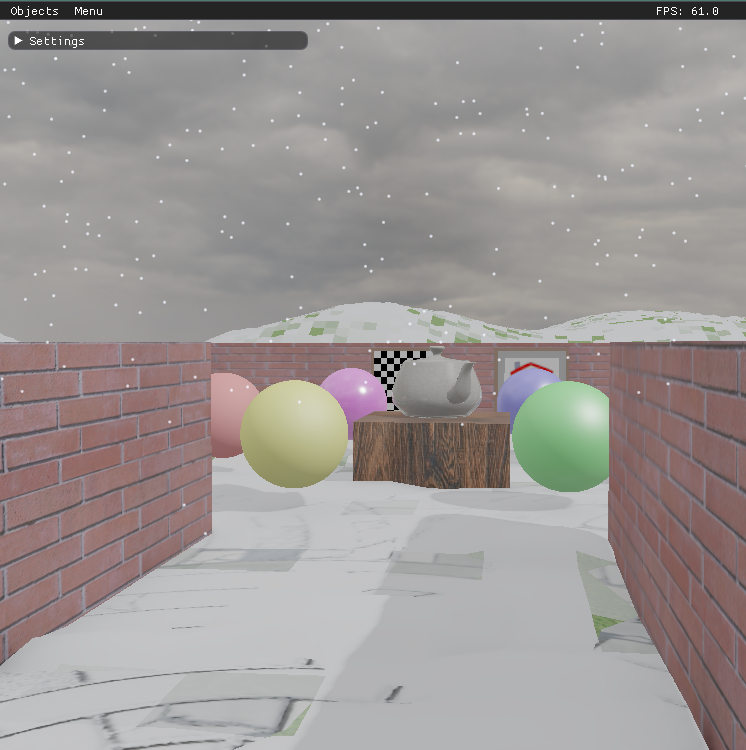
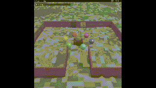
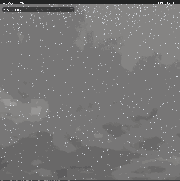
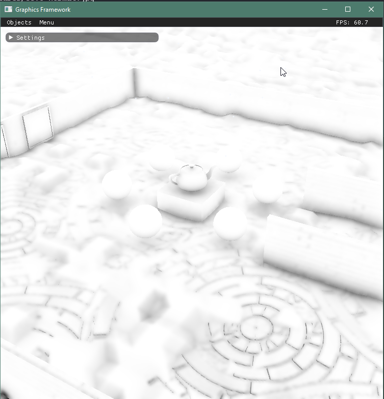

# Rendering Snow on the GPU

This branch extends a deferred OpenGL renderer with falling snow and accumulating snow piles. A GPU particle simulation records landing events in an integer height field, a compute shader redistributes the deposited snow, and the G-buffer shaders use that field to displace geometry and blend snow materials. Particle simulation, deposition, and rendering stay on the GPU without per-frame CPU readback.

The implementation is based on *Rendering Snowing Scene on GPU* by Jun Zhang, Xingquan Cai, and JinHong Li (2010).



## Features

- **16,384 snow particles** simulated in a 128 × 128 texture grid using ping-pong framebuffers.
- **Runtime gravity and wind** controls, with automatic particle respawn after landing.
- **256 × 256 integer height field** updated with atomic additions for concurrent deposition.
- **Compute shader relaxation** that moves snow toward lower neighboring cells.
- **Displaced ground and floor geometry**, reconstructed normals, and snow material blending.
- Integration with moment shadow maps, reflections, image-based lighting, screen-space ambient obscurance, and local lights.

## Build and run

### Requirements

- Visual Studio with the C++ desktop workload and the **v143** toolset for the supplied Windows project.
- A GPU and driver supporting **OpenGL 4.3 / GLSL 4.30**, including compute shaders and image atomics. Although `framework.cpp` requests a 3.3 context, the snow update and compute shaders require 4.3 functionality; the actual context must provide it.
- The framework dependencies under `libs/`: GLFW, glbinding, GLM, Dear ImGui with its GLFW/OpenGL backends, and stb headers. These dependencies are ignored by Git and must be supplied separately for a fresh clone. Windows library binaries must match the project's **Win32/x86** target.

### Required environment map

`scene.cpp` currently loads this file during initialization:

```text
skys/overcast_soil_puresky_4k.hdr
```

The HDR was removed from this branch and must be restored locally before running. Alternatively, change the `HDR` constructor path in `Scene::InitializeScene` to an available environment map, such as `skys/Road_to_MonumentValley_Ref.hdr`. Using another map changes the sky and image-based lighting. The program exits if the configured HDR cannot be loaded.

### Windows

1. Open `framework.sln` in Visual Studio.
2. Select **Debug | Win32** and ensure the required headers and libraries are available under `libs/`.
3. Set the debugger working directory to the repository root so relative shader, texture, and sky paths resolve.
4. Build and run the `framework` project.

From a Visual Studio Developer PowerShell, the equivalent build and launch commands are:

```powershell
msbuild framework.sln /p:Configuration=Debug /p:Platform=Win32
.\Debug\framework.exe
```

Run these commands from the repository root. The project copies `glbinding.dll` into the output directory after building. Initialization also regenerates `irradiance_map.hdr` from the selected environment map.

The repository includes a Linux `Makefile`, but it is inherited from the framework and is not a verified build path for this branch. In particular, its source list omits `HDR.cpp`; it needs adjustment before use.

## Controls

Expand the **Settings** window and scroll to **Snow** to adjust the simulation.

| Setting | Default | Effect |
| --- | --- | --- |
| Enable Snow | On | Enables particle updates, deposition, snow displacement/material blending, and particle drawing. |
| Gravity | 9.8 | Downward acceleration along the negative Z axis. |
| Wind | (0.3, 0.1, 0.0) | Acceleration applied to particles in world space. |
| Particle Size | 4.0 | Point sprite size parameter. |
| Accum Rate | 0.2 | Height added to a grid cell for each particle landing, in world units. |
| Pile Height | 1.5 | Multiplier applied to sampled snow height for vertex displacement. |

The **Pile Height** label controls a displacement scale, rather than enforcing a hard maximum on accumulated height.

Use the **Menu** dropdown to switch between normal rendering and diagnostic views, including **SSAO Factor**. **F11** toggles fullscreen; **Esc** or **Q** exits.

## Rendering pipeline

| Order | Pass | Purpose |
| --- | --- | --- |
| 1 | Shadow | Store four depth moments from the light's perspective. |
| 2 | Shadow blur | Apply a separable Gaussian filter to the moment shadow map. |
| 3 | Reflections | Render top and bottom paraboloid reflection maps. |
| 4 | Snow update | Integrate particle motion, deposit landed snow, and respawn particles. |
| 5 | Snow deposition | Relax the height field by redistributing snow to lower neighbors. |
| 6 | G-buffer | Write geometry and material data, including displaced snow surfaces. |
| 7 | SSAO | Estimate ambient obscurance from the G-buffer. |
| 8 | SSAO blur | Apply horizontal and vertical bilateral filtering. |
| 9 | Deferred lighting | Combine BRDF lighting, diffuse spherical-harmonic IBL, sampled specular IBL, and moment shadows. |
| 10 | Local lights | Add point light contributions using light volumes. |
| 11 | Snow particles | Draw the falling snow as point sprites over the lit scene. |

### Particle simulation

Two framebuffers, `snowFboA` and `snowFboB`, each hold two `GL_RGBA32F` attachments: world-space position and velocity. Each update reads one framebuffer and writes the other before swapping their roles.

The fullscreen update pass runs one fragment per particle and integrates motion as:

```glsl
accel = vec3(0.0, 0.0, -gravity) + wind;
vel = vel + accel * dt;
pos = pos + vel * dt;
```

The CPU caps the simulation time step at 0.05 seconds. When a particle falls below `groundZ`, its XY position is mapped into the height field and recorded before it respawns at a randomized XY position at the top of the spawn volume.

The render vertex shader uses `gl_VertexID` and `texelFetch` to read particle positions directly from the current texture. A dedicated empty VAO supports the `GL_POINTS` draw without uploading particle positions to a vertex buffer.

### Deposition and relaxation

The `GL_R32I` height texture stores world-space height multiplied by 1,000: a stored value of 200 represents 0.2 world units. Landings use `imageAtomicAdd` so multiple particles can safely increment the same cell.

The compute shader uses 16 × 16 threads per workgroup and dispatches 16 × 16 workgroups over the 256 × 256 field. For each interior cell, it:

1. Checks the four cardinal neighbors against a roll threshold of approximately 1.5 times one landing increment.
2. Leaves the cell unchanged if no neighbor is sufficiently lower.
3. Otherwise subtracts one landing increment and divides it among qualifying neighbors.

A one-cell border protects neighbor accesses. An image-access memory barrier separates particle landing writes from relaxation; a second barrier covering image access and texture fetches makes the relaxed field available to the G-buffer shaders.

### Rendering accumulated snow

On ground and floor objects, the vertex shader maps world XY coordinates into the height texture and raises each vertex along Z. Central differences over neighboring heights produce a snow normal, which is blended with the original geometry normal according to snow depth.

The fragment shader samples the same field and blends toward a slightly blue-white diffuse color with low specular reflectance. Coverage is weighted by the upward-facing normal component. The material scale is `1.0 / snowAccumRate`, allowing a single landing increment to fully whiten an upward-facing cell before relaxation redistributes its height.

## Results

The images and animations below show falling particles, snow coverage, displaced piles, and ambient obscurance around the accumulated snow.

### Snowfall and accumulation



### Alternate view



### Ambient obscurance



## Implementation notes and limitations

- **Ground-plane landing detection:** particles land when their Z coordinate falls below `groundZ`. The current implementation does not test collisions against arbitrary scene objects or the changing snow surface, so it does not simulate obstacle sheltering.
- **Ground and floor coverage:** snow displacement and material blending are restricted to these object IDs. The height field is a single XY layer rather than a volumetric or multilayer snow representation.
- **Parallel relaxation:** atomic operations protect individual additions, but cells read and modify the same field during a dispatch. Relaxation therefore approximates a serial redistribution process. Integer division can also discard a remainder when splitting an increment among neighbors.
- **Mesh resolution:** visible pile geometry depends on the existing ground and floor vertices; there is no adaptive tessellation.
- **Initialization memory:** the report describes a startup stack overflow caused by a large fixed-size height-field array. Moving initialization storage to the heap resolved it.
- **Particle drawing:** the report describes fixing invisible particles by using a dedicated empty VAO with the texture-based `gl_VertexID` rendering path.

## Key files

| File | Responsibility |
| --- | --- |
| `scene.cpp` / `scene.h` | Snow resources, defaults, controls, pass orchestration, and synchronization. |
| `fbo.cpp` / `fbo.h` | Framebuffer setup, including dual particle attachments. |
| `glsl shaders/snowUpdate.vert` / `snowUpdate.frag` | Fullscreen particle simulation and atomic landing deposition. |
| `glsl shaders/snowDeposit.comp` | Height-field stability checks and redistribution. |
| `glsl shaders/snowRender.vert` / `snowRender.frag` | Particle position fetch and point sprite rendering. |
| `glsl shaders/gBuffer.vert` / `gBuffer.frag` | Snow displacement, normal reconstruction, and material blending. |

## References

- Jun Zhang, Xingquan Cai, and JinHong Li. *Rendering Snowing Scene on GPU* (2010).
- Niko Bekris. *Project 5 Rendering Snow on GPU Implementation Report*, CS 562, Spring 2026.
- [LearnOpenGL — Introduction to Compute Shaders](https://learnopengl.com/Guest-Articles/2022/Compute-Shaders/Introduction).
- [OpenGL Wiki — Image Load Store](https://www.khronos.org/opengl/wiki/Image_Load_Store).
